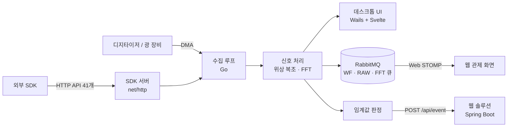

# 레거시 C의 Go 재구축

> 2026 · 광섬유 분포형 센서(DAS) 관제 시스템 · 역할: 재구축 제안·설계·구현, 5명 팀 리딩
> Go · CGO · net/http · RabbitMQ · Wails/Svelte

## 배경

광섬유 한 가닥을 수십 km 센서로 쓰는 진동 감시 시스템입니다. 수집 장비(디지타이저)에서 DMA로 받은 데이터를 신호 처리해 화면에 보여주고, 이상 신호가 나오면 웹 관제 솔루션에 알립니다.

기존 HMI(장비를 제어하고 데이터를 수집·처리해 화면에 보여주는 프로그램)는 Windows 전용 C 애플리케이션이었고, 다음 문제가 반복됐습니다.

- `sprintf` 고정 버퍼가 100곳 이상 → 버퍼 오버플로 위험
- 내장 HTTP 서버가 소켓 오류 시 `exit(1)` → 외부 SDK가 연결만 끊어도 프로세스 전체가 종료
- HTTP 요청을 순차 처리, 타임아웃 없음
- Windows 전용이라 Linux 장비에 올릴 수 없음

## 판단: 왜 Go인가

| 고려한 것 | 판단 |
|---|---|
| C 코드를 고치며 유지 | 메모리 오염 위험이 코드 전반에 퍼져 있어 부분 수정으로는 끝나지 않음 |
| Java/JVM | 하드웨어 SDK가 C 라이브러리라 JNI 부담이 큼 |
| **Go** | GC로 메모리 관리 실수를 구조적으로 줄이고, CGO로 하드웨어 C 라이브러리를 그대로 호출 가능. Windows/Linux 단일 코드베이스 |

하드웨어 제어는 C 라이브러리에 남기고, 가공·분석·전송은 Go가 맡는 혼합 구조로 정했습니다. UI는 Wails + Svelte로 데스크톱 앱 형태를 유지했습니다.

## 구조

## 주요 결정

**1. 외부 계약은 그대로, 결함은 고친다.** SDK가 쓰는 HTTP API 41개는 URI와 응답 형식을 바이트 단위로 유지했습니다. 대신 소켓 처리는 `net/http`로 바꿔 요청별 goroutine, 10초 읽기/쓰기 타임아웃, panic recover를 넣었습니다. 레거시의 `exit(1)`은 재현하지 않았습니다.

**2. 데이터는 유형별로 나눠 발행한다.** 원시 데이터(RAW), 워터폴(WF), FFT를 각각 다른 큐로 보내 소비자가 필요한 것만 구독하게 했습니다. 발행은 수집 루프를 막지 않도록 goroutine으로 분리했습니다.

## 검증: 차분 퍼징

이관에서 가장 위험한 건 신호 처리 결과가 미묘하게 달라지는 것입니다. CGO로 레거시 C 함수를 직접 호출해 Go 결과와 비교하는 퍼징 테스트를 만들었고, 위상 복조 결과가 **28,065회 입력에서 오차 1e-7 이하**로 일치하는 것을 확인한 뒤 전환했습니다.

검증 도구 자체도 틀릴 수 있었습니다. 처음 비교 기준으로 쓴 C 코드는 레거시를 손으로 옮겨 적은 재현 코드였는데, 2채널 모드의 DC 제거에서 Go와 재현 코드가 같이 틀려 테스트를 통과했습니다. 그 뒤로 기준 코드도 실제 레거시 소스와 대조합니다.

→ 방식 예제: [samples/differential-fuzz-go](../samples/differential-fuzz-go)

## 결과

- 외부 SDK가 쓰던 API 41개를 그대로 유지해 연동 쪽 수정 없이 전환
- Windows/Linux 공통 코드베이스, Linux 릴리스 CI
- 운영 배포 후 메모리 관련 장애 두 건은 원인까지 확정해 수정 → [장애 분석](02-incident-analysis.md)
- C 개발자 2명이 Go 코드베이스로 넘어올 수 있도록 C→Go 교육 커리큘럼 작성(AI 활용)
