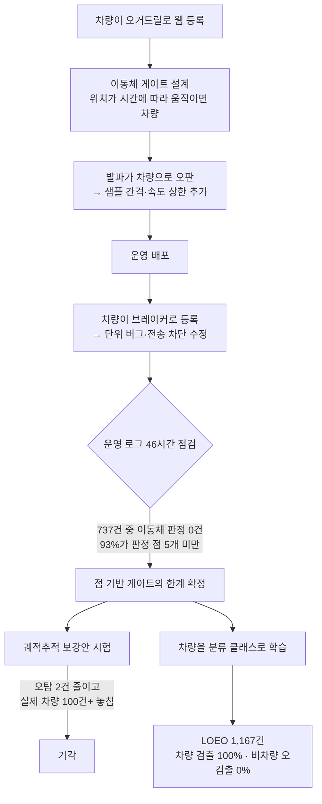

# 알림 판정 품질 개선: 차량 오탐 줄이기

> 2026 · 지중 전력구 공사감시 · 역할: 문제 정의, 게이트 설계·구현, 방향 전환 결정
> Go · Python

## 문제

광섬유 센서로 지하 전력구 주변 공사 장비(오거드릴, 브레이커, 굴착기 등)를 감지해 관제 웹에 알리는 시스템입니다. 그런데 **지나가는 차량이 장비로 등록되는 일**이 반복됐습니다. 오탐이 쌓이면 현장은 알림 자체를 믿지 않게 됩니다. 그래서 장비 분류 정확도를 올리기 전에 차량부터 걸러내자고 판단했습니다.

## 진행 과정

## 판단 기록

| 시점 | 선택지 | 결정과 근거 |
|---|---|---|
| 게이트 설계 | 분류기 개선 vs 차량 사전 차단 | 사전 차단. 분류기에 차량이 들어가는 한 장비 클래스가 오염됨 |
| 출시 범위 | 판정 파라미터 전체 조정 vs 게이트만 | 게이트만 출시, 판정 파라미터는 동결. 운영 데이터 없이 여러 값을 함께 바꾸면 원인 추적이 불가능 |
| 게이트 한계 | 궤적추적으로 보강 vs 방향 전환 | 프로토타입을 실제 데이터로 돌려 보니 놓치는 차량이 훨씬 많아 **기각** |
| 대안 | 차량을 분류 클래스로 | 이벤트 하나의 점 개수와 무관하게 신호 형태로 판단할 수 있음 |

## 만들지 않기로 한 것

- **궤적추적 게이트**: 오탐 2건을 줄이는 대신 실제 차량 100건 이상을 새로 놓쳤습니다.
- **학습 게이트(배경 신호 사전 필터)**: 다른 기관 파이프라인에서는 효과가 있었지만, 우리 데이터에서는 McNemar 검정 p=1.0으로 유의한 차이가 없어 도입하지 않았습니다.
- **다른 AI가 제안한 "탐지율 60% 이상" 설정값**: 같은 운영 데이터로 시뮬레이션하니 장비 재현율 19%대, 시간당 알림 577~636건이어서 채택하지 않았습니다.

## 그 밖의 개선

- 특징벡터 분류기의 학습·추론 창 크기 불일치를 근본 수정 → 오거드릴 재현율 58.3% → 71.4%
- 브레이커·오거드릴 혼동 원인을 세 가지 가설(거리, 신호 세기, 데이터 다양성)로 검증해 학습 세션 다양성 부족으로 확정
