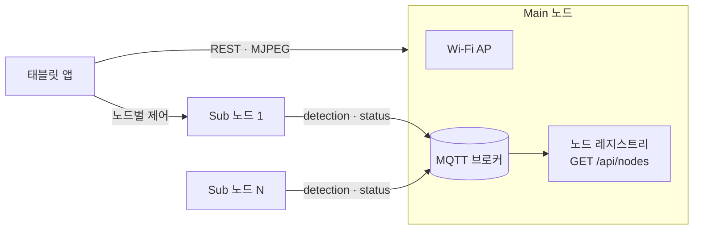
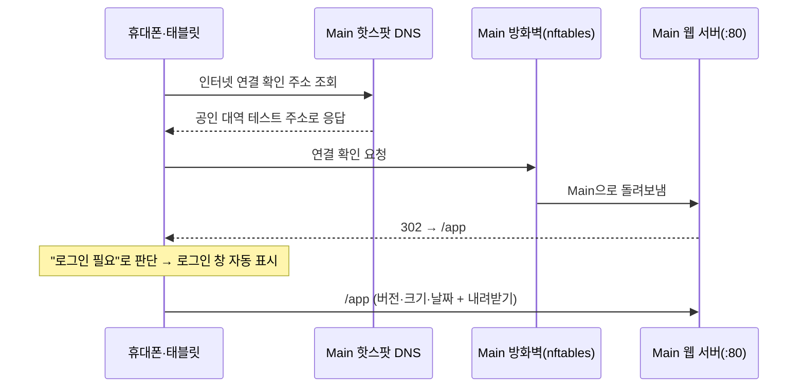

# 도로 공사 신호수 경보 장치: MQTT 멀티노드

> 2026.09 ~ 10 · 엣지 AI 안전 장치 · 역할: 멀티노드·앱·배포 도구 (전체 커밋 70개 중 64개)
> Python · Flask · MQTT(Mosquitto) · Kotlin WebView · TypeScript/Preact

## 개요

도로 공사 현장의 신호수에게 접근 차량을 알리는 장치입니다. 카메라가 달린 Raspberry Pi 노드가 NPU(Hailo-8)로 차량을 감지하고, 위험 구역에 들어오면 경광등·부저·음성·현장 전광판으로 경보합니다. 현장 관리자는 태블릿 앱으로 노드를 운용합니다.

## 구조

## 주요 결정

**MQTT를 고른 이유.** REST나 WebSocket은 서로의 주소를 알아야 하고, UDP 브로드캐스트는 전달 보장이 없고 AP 격리 환경에서 막힙니다. 브로커 하나에 노드들이 붙는 MQTT는 노드가 늘어도 설정이 바뀌지 않습니다.

**노드 자가 등록.** 각 노드가 `guard/{node_id}/status`를 retained 메시지로 올리고, 연결이 끊기면 LWT(Last Will)로 오프라인이 자동 반영됩니다. 앱은 Main 주소 하나만 알면 됩니다. 노드 ID는 CPU 시리얼에서 자동으로 만들어 현장 설치 시 ID 충돌을 없앴습니다.

**전달 보장.** 감지 메시지는 QoS 1로 보내 최소 한 번 전달을 보장합니다.

## 인터넷 없는 현장에 앱과 소프트웨어 배포하기

공사 현장에는 인터넷도 사내망도 없습니다. 앱 스토어를 쓸 수 없고, 현장 담당자가 매번 USB로 APK를 옮겨 설치하게 할 수도 없습니다. 그래서 **Main 노드를 배포 서버로 삼았습니다.**

### 1. Wi-Fi에 붙으면 설치 페이지가 저절로 뜬다 (캡티브 포털)

- 휴대폰은 Wi-Fi에 붙을 때 정해진 주소로 인터넷 연결을 확인합니다. Main의 DNS가 이 주소를 가로채고, 방화벽이 요청을 Main으로 돌리고, 웹 서버가 `/app`으로 302를 돌려주면 휴대폰은 "로그인이 필요한 Wi-Fi"로 판단해 로그인 창을 띄웁니다. 그 창이 곧 앱 설치 페이지입니다.
- 실제로 부딪힌 문제: Android는 연결 확인 응답이 사설 IP면 무시합니다. 그래서 DNS가 공인 대역의 테스트용 주소로 답하고, 방화벽에서 그 주소를 Main으로 돌리는 방식으로 풀었습니다.
- 캡티브 포털은 Main에서만 켜지고 설정 값 하나로 끌 수 있습니다. 앱 서비스가 시작할 때 DNS·방화벽 설정을 스스로 맞추므로 현장에서 따로 설정할 것이 없습니다.

### 2. 앱 업데이트를 안전하게 올리기

| 위험 | 대응 |
|---|---|
| 서명 키가 바뀌면 기존 설치 위로 업데이트가 안 됨 | 모든 릴리스를 같은 키로 서명, 키는 저장소 밖에 두고 별도 백업 |
| 서명 안 된 APK가 올라감 | 배포 스크립트가 `apksigner verify`로 확인하고, 실패하면 업로드 거부 |
| 내려받는 중에 파일이 교체되어 깨짐 | 임시 이름으로 올린 뒤 이름만 바꿔치기 |
| 버전 번호를 낮게 올려 업데이트 실패 | 빌드 메타데이터에서 버전 정보를 만들어 `/app` 페이지에 표시 |

서비스 재시작 없이 APK만 바뀌므로, 경보가 동작하는 중에도 앱을 업데이트할 수 있습니다.

### 3. 노드 소프트웨어 현장 배포

- 묶음에는 **커밋된 파일만** 들어갑니다. 커밋하지 않은 수정이 섞이면 경고를 띄웁니다. 어떤 버전이 현장에 나가 있는지 커밋 ID로 추적할 수 있습니다.
- 설치 전에 기존 버전을 백업해 두므로, 문제가 생기면 백업을 풀고 재시작하면 됩니다.
- 사무실에서는 재시작 없이 복사본 폴더에 먼저 설치해 보는 시험 모드를 씁니다.

## 결과

| 항목 | 이전 | 이후 |
|---|---|---|
| 전원 투입 → 첫 차량 인식 | 약 2~3분 (현장 보고) | **31초** (9회 실측 평균) |
| 2명 동시 영상 시청 | 4.6fps | **9.3fps** (프레임 공유 허브) |

부팅 지연은 systemd의 `network-online.target` 대기와 NPU 초기화 블로킹이 원인이었습니다.

## AI가 만든 코드에서 잡은 결함

- MQTT 구독이 N:N으로 잘못 연결된 문제
- 멀티노드 1차 구현의 결함 10건
- 노드 ID 변경 후 예전 retained status가 남아 유령 노드가 보이던 문제
