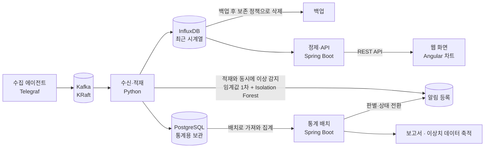

# 시계열 수집·분석 파이프라인

> 2021 ~ 2025 · DB 모니터링 백엔드 · Java · Spring Boot · Kafka · InfluxDB · PostgreSQL · Python · Angular

## PostgreSQL HA 클러스터 모니터링 제품 (2023.07 ~ 2025.04, 1년 10개월)

PostgreSQL 고가용성 클러스터(Patroni·etcd, Virtual IP, HAProxy, 복제, 백업)의 상태를 하루 1TB 규모(테스트 환경 기준) 시계열로 수집하고 이상 패턴을 실시간으로 잡아내는 분산 모니터링 시스템입니다. 아키텍처 설계와 프로젝트 리딩을 맡았습니다.

한 제품을 두 회사에 걸쳐 이어서 개발했습니다. 처음 회사에서 Telegraf → InfluxDB 수집과 Spring Boot 조회 API로 시작했고, 회사 사정으로 제품이 다른 회사로 이관된 뒤에는 상표 문제로 이름을 바꿔 HA 클러스터 감시, 단계별 알림, 설치 도구까지 넓혔습니다.

| 기간 | 단계 |
|---|---|
| 2023.07 ~ 2024.06 | 수집 파이프라인(Telegraf → InfluxDB)과 Spring Boot 조회 API 설계·구현 |
| 2024.06 ~ 2025.04 | 제품 이관 후 이름 변경. HA 구성·복제·DBMS KPI 수집 확대, 이상 감지와 단계별 알림, 설치용 TUI, 모니터링 API 확장 |



**저장소를 두 개로 나눈 이유.** 시계열 DB는 대량 쓰기와 최근 구간 조회에 강하지만, 특성상 데이터를 오래 들고 있기 어렵습니다. 그래서 InfluxDB는 백업한 뒤 보존 정책으로 오래된 데이터를 지우고, 같은 데이터를 PostgreSQL에도 함께 적재했습니다. 긴 기간의 통계는 Spring Boot 배치가 PostgreSQL에서 가져가 집계합니다. 화면 API는 InfluxDB만 읽고 PostgreSQL은 전혀 건드리지 않아서, 무거운 통계 집계가 실시간 화면 응답을 느리게 만들지 않습니다.

계층마다 한 가지 일만 맡깁니다. Telegraf는 수집해 보내고, Python은 받아서 적재하고, Spring Boot는 정제해 API로 제공하고, Angular 화면은 API만 호출해 차트를 그립니다. 화면이 DB나 수집 계층을 직접 알지 못하므로, 뒤쪽 저장 구조가 바뀌어도 API 계약만 지키면 화면은 그대로입니다.

- **수집과 처리 분리**: 처음에는 수집 에이전트가 서버로 데이터를 직접 보냈는데, 서버 부하가 크고 트래픽이 몰리면 불안정했습니다. 중간에 Kafka를 두어 수집 쪽은 쓰기만 하고, 서버는 자기 속도로 읽어 가게 바꿨습니다.

  ```mermaid
  flowchart LR
      subgraph 이전
        A1[수집 에이전트] -- 직접 전송 --> S1[서버<br/>부하 집중·불안정]
      end
      subgraph 이후
        A2[수집 에이전트] --> K2[(Kafka<br/>KRaft)] --> S2[서버<br/>자기 속도로 소비]
      end
  ```

- **KRaft 모드**: Kafka는 ZooKeeper 없이 메타데이터를 자체 관리하는 KRaft 모드로 구성했습니다. 별도 ZooKeeper 클러스터를 띄우고 관리할 필요가 없어 운영할 구성요소가 줄었습니다.
- **수집 지표**: PostgreSQL 고가용성 클러스터를 한 화면에서 보기 위해 아래 영역을 수집했습니다.

  | 영역 | 지표 |
  |---|---|
  | 고가용성 구성 | Patroni·etcd 상태, 리더 변경 이력, Virtual IP·Keepalived 상태 |
  | 네트워크·접속 | HAProxy 요청 수·세션·요청/응답, 네트워크 지연·응답 시간(P50·P95·P99 등 백분위) |
  | 클러스터·복제 | 노드별 세션·역할, 복제 상태와 지연 |
  | DBMS KPI | TPS, 커밋 비율, 활성 세션, Logical I/O, Lock·Dead Lock, Long SQL, Idle in Transaction, WAL 크기, TXID 나이, 테이블 Bloat |
  | 시스템 | 노드별 CPU, 메모리, 디스크 I/O, Swap |
  | 백업 | 전체·증분·차등 백업 상태, 저장소 사용량 |
  | 기타 | 메모리 DB, 샤딩, 서비스 프로세스 상태 |

  지연과 응답 시간은 평균 하나가 아니라 **P50·P95·P99 같은 백분위**로 봤습니다. 평균은 대부분의 정상 요청에 묻혀 일부 사용자가 겪는 긴 지연을 가립니다. P50이 그대로인데 P99만 오르면 일부 요청만 느린 것이고, P50까지 오르면 전체가 느려진 것이라 원인을 좁히는 출발점이 달라집니다.

- **읽기·쓰기 분리**: HAProxy가 쓰기는 리더로, 조회(SELECT)는 서브 노드로 보내 리더의 부하를 줄였습니다.

  ```mermaid
  flowchart LR
      APP[애플리케이션] --> VIP[Virtual IP] --> HA[HAProxy]
      HA -- 쓰기 --> L[(리더)]
      HA -- 조회 SELECT --> R1[(서브 노드)]
      HA -- 조회 SELECT --> R2[(서브 노드)]
      L -- 복제 --> R1
      L -- 복제 --> R2
      P[Patroni + etcd] -. 리더 정보 .-> HA
      AG1[Python 에이전트<br/>노드마다] -. Patroni·etcd·시스템 정보 API .-> MON[모니터링]
  ```

  조회가 서브 노드로 가므로 복제가 밀리면 오래된 데이터를 읽게 됩니다. 그래서 복제 상태와 지연을 핵심 감시 지표로 두었습니다.

- **리더 변경(failover)**: 리더 노드에 문제가 생기면 Patroni가 서브 노드를 새 리더로 승격하고, Virtual IP가 새 리더로 옮겨 가며 HAProxy가 쓰기 접속을 새 리더로 돌립니다. 지금 누가 리더인지는 Patroni가 etcd에 기록합니다. 모니터링 쪽에서는 각 노드(리더, 서브, 스탠바이)에 Python 에이전트를 올려 Patroni·etcd 상태와 시스템 정보를 API로 제공했습니다. 이 API로 노드 역할과 리더 변경을 감지해 Virtual IP·HAProxy 상태 변화와 함께 타임라인에 남기고 알림으로 알립니다.
- **역할별 서버 분리**: 대량 수신·적재는 Python, 정제·통계 집계와 API 제공은 Spring Boot가 맡아 부하를 나눴습니다.
- **스키마 설계**: InfluxDB 태그/필드 구조를 조회 패턴에 맞춰 설계했습니다.
- **알림 단계화**: 이상 한 번에 바로 위험 알림을 띄우면 일시적인 튐에도 운영자가 불려 나갑니다. 그래서 감지와 판정을 나눴습니다. Python이 적재하면서 1차로 임계값을 검사하고, 임계값만으로 잡기 어려운 특정 이상은 Isolation Forest로 감지해 알림을 등록합니다. 그러면 배치가 그것이 일시적인 단순 이상치인지 판별해 Pending으로 두고, 같은 이상이 반복되면 Critical로 올립니다. 감지는 데이터가 들어오는 즉시, 판정은 시간 범위를 봐야 하므로 배치에서 하도록 나눴습니다.

  ```mermaid
  stateDiagram-v2
      [*] --> 등록: Python이 적재 중 이상 감지
      등록 --> 해제: 단순 이상치<br/>(순간적인 튐, 예정된 작업)
      등록 --> Pending: 단순 이상치가 아님
      Pending --> Critical: 같은 이상이 반복
  ```

  배치가 단순 이상치로 보는 경우는 두 가지입니다.
  - **순간적인 튐**: 한두 번만 기준을 넘고 곧 평소 수준으로 돌아오는 경우. 짧은 트래픽 몰림이나 큰 쿼리 하나가 P99 지연을 잠깐 끌어올리는 경우가 대표적입니다.
  - **예정된 작업**: 야간 백업, 정기 배치처럼 알려진 작업 시간대와 겹치는 경우.

- **통계 배치**: 보고서용 집계와 이상치 데이터 축적을 맡았습니다. 쌓인 이상치 데이터는 이후 판별 기준을 다듬는 근거가 됩니다.

## DB 성능 모니터링 (2021.11 ~ 2023.05)

PostgreSQL 계열 DB의 쿼리 단위 실행 통계를 수집해 병목을 찾는 모니터링 시스템입니다. 수집기를 재구축하고 `pg_stat_monitor`를 연동했으며, InfluxDB 태그 구조와 보존 정책을 설계했습니다.