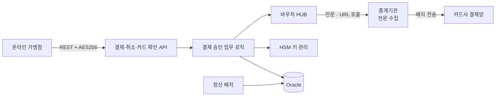

# 결제·정산 백엔드 (9년 6개월)

> 2012 ~ 2021 · 핀테크 기업 · Java · JEX(금융 프레임워크) · Oracle PL/SQL · HSM

## 지자체 바우처·제로페이 결제 연계 (2019.11 ~ 2020.12)

지자체 바우처를 쓸 수 있는 가맹점을 넓히기 위해 카드사 결제망과 연동하고 결제 보안을 강화한 프로젝트입니다.

- 카드사 결제망과는 직접 연결하지 않고 중계기관을 거쳤습니다. 우리 쪽 바우처 HUB가 중계기관 규격의 전문을 URL로 전송하면, 중계기관이 이를 모아 카드사로 배치 전송하는 구조입니다. IC카드 승인이 가능하도록 결제 승인 구조도 개편했습니다.
- 온라인 가맹점용 결제·취소·카드 유효성 확인 REST API를 설계·개발했습니다.
- 결제 데이터는 HSM으로 키를 관리하고 AES256으로 암호화했습니다.

## 프레임워크 구조 (JEX)

금융권에서 쓰는 국산 프레임워크로, 대외기관 연동과 전문 처리를 공통 모듈로 제공합니다. 실제 코드는 두 모듈을 중심으로 작성했습니다.

| JEX 모듈 | 역할 | Spring으로 치면 |
|---|---|---|
| IDO | SQL 실행, 동적 쿼리 | MyBatis Mapper, Repository |
| IMO | 대외 서버 연동, 메시지 변환·실행 | 외부 연동 클라이언트 + 메시지 변환기 |
| Batch Service | 조건별 스케줄 배치 | Spring Batch, Quartz |

## 공공·재단 지원금 정산 (2013 ~ 2021)

여러 공공기관·재단의 지원금 정산 시스템을 8년간 개발·운영했습니다. 기관마다 다른 정산 기준을 설정으로 분리하고, PL/SQL로 정산 데이터 무결성을 검증했습니다. 은행 수금 내역 확인 서비스와 은행 데이터 연동도 개발했습니다.
