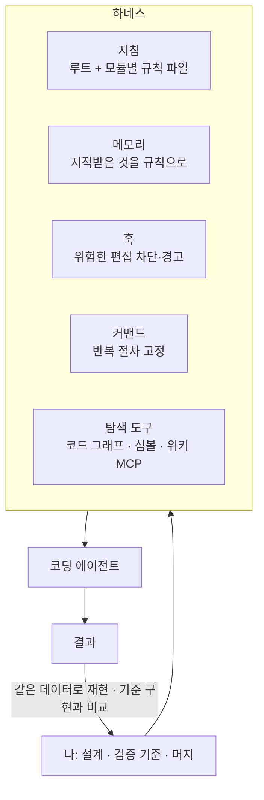
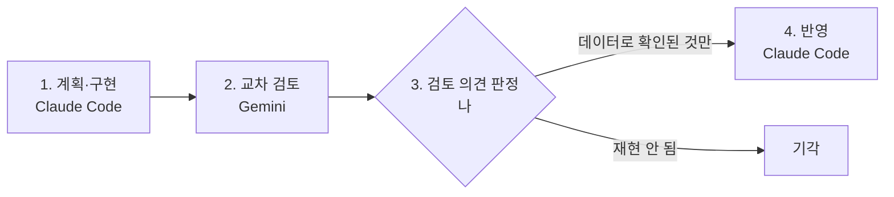

# 코딩 에이전트와 일하는 방식

설계 방향, 검증 기준, 머지 여부는 직접 정하고, 계획 초안과 구현은 AI에게 맡깁니다. 핵심은 두 가지입니다.

1. **에이전트가 실수하기 어려운 환경(하네스)을 만든다.** 지침, 메모리, 훅, 커맨드, 탐색 도구를 저장소에 둡니다.
2. **AI의 결과는 같은 데이터로 재현해 보고 반영한다.**

---

## 에이전트에게 준 하네스

### 1. 지침: 모든 세션이 같은 원칙에서 시작

저장소 루트와 모듈 폴더마다 규칙 파일을 두었습니다. 모듈마다 빌드 방법과 주의점이 달라서, 에이전트가 들어간 폴더의 규칙을 함께 읽게 했습니다.

- 레거시가 기준이다. 우회 로직을 새로 만들지 않고 근본 원인을 고친다.
- 레거시의 *계약*(API 주소, 데이터 의미, 하드웨어 시퀀스)은 따르되 *결함*은 재현하지 않는다.
- 빌드 검증은 프론트엔드·바인딩까지 함께 만드는 명령으로만 한다. Go 컴파일만으로는 바인딩 누락을 못 잡는다.

### 2. 메모리: 한 번 지적한 실수는 규칙으로 남긴다

에이전트가 실수하면 고치고 끝내지 않고, **규칙 / 이유 / 적용 방법 / 계기**를 메모리에 남겨 다음 세션부터 지키게 했습니다. 프로젝트 하나에 작업 규칙 18개, 조사·설계 기록 37개가 쌓였습니다.

| 규칙 | 계기 |
|---|---|
| 커밋·푸시는 요청할 때만 | 에이전트가 자동으로 푸시했는데 실제로는 덜 고쳐진 상태였음 |
| 하드웨어 프로토콜은 실측 로그 없이 고치지 않는다 | 두 세션이 시리얼 명령 끝의 개행을 넣었다 뺐다 반복. 둘 다 원인이 아니었음 |
| 외부 API 계약은 출처가 충돌하면 단정하지 않는다 | 레거시 코드와 매뉴얼의 URL이 달랐는데 한쪽을 "확정"으로 기록 |
| 저장소 설정이 아니라 운영 설정으로 판단한다 | 저장소 값만 보고 "필터가 꺼져서 오탐"이라고 결론. 운영에서는 켜져 있었음 |
| 요청 범위를 조용히 줄이지 않는다 | 위험해 보인다는 이유로 요청보다 작은 수정만 하고 말하지 않음 |
| 손으로 고른 사례로 결론 내지 않는다 | 몇 건에서 완벽했던 궤적추적이 전체 821건에서 차량 유지율 96% → 60%대로 무너짐 |
| 사용자가 테스트하는 위치에서 고친다 | 별도 워크트리에서 고쳐 놓고 "됐다"고 보고. 사용자 체크아웃에는 반영 안 됨 |
| 백그라운드 작업을 반복 확인하지 않는다 | 몇 시간짜리 배치를 계속 폴링해 토큰 낭비 |

### 3. 훅: 말로 부탁하지 않고 막는다

| 훅 | 동작 |
|---|---|
| `sprintf` 차단 | 편집 내용에 `sprintf(`가 있으면 저장 전에 **차단**하고 `snprintf`/`fmt.Sprintf`를 안내. 레거시에 100곳 넘게 퍼진 버퍼 오버플로 패턴이 새로 늘지 않게 함 |
| 레거시 C 수정 전 경고 | 레거시 C 파일을 건드리려 하면 코드 지도 문서를 먼저 읽었는지 확인 |
| 탐색 전 코드 그래프 안내 | 파일 검색·읽기 전에 코드 그래프 질의를 먼저 쓰도록 안내 |

### 4. 커맨드: 검증된 절차를 명령으로 고정

| 커맨드 | 하는 일 |
|---|---|
| raw 이벤트 스캔 | 원시 데이터에서 차량·장비 후보를 분리하고 HTML 리뷰 페이지를 만든다. 사용자가 육안으로 확인한 차량 5건을 100% 재현한 절차를 그대로 고정 |
| 계획서 검토 | 작업 계획을 코드베이스·규칙 기준 네 가지로 검토하고 원문 아래에 보완사항을 덧붙인다 |
| 이슈 등록 | 정해진 6섹션 본문으로 이슈를 만들고 프로젝트 보드에 연결, 연결까지 확인한다 |
| 일일 기록 | 그날 작업을 공용 폴더에 프로젝트별로 기록 |

### 5. 탐색 비용 줄이기

| 도구 | 쓰임 |
|---|---|
| 코드 지도 문서 | 레거시 C에서 어떤 기능이 어느 파일에 있는지 정리. 에이전트가 전체를 뒤지지 않게 함 |
| 코드 그래프 | 파일·함수 관계를 그래프로 만들어 질의 |
| 심볼 탐색 MCP | 함수·타입 단위로 코드를 찾고 고침 |
| 위키 MCP (직접 제작) | 작업 기록과 대화를 Obsidian 위키로 정리하는 Python CLI 겸 MCP 서버. 복사·해시·diff·lint는 도구가 하고, 에이전트에게는 바뀐 원본 목록·diff·요약만 돌려줘 읽는 양을 줄임 |

---

## Claude와 Gemini 교차 검증

구현은 Claude Code로 하고, 결과를 Gemini로 한 번 더 검토합니다. 같은 모델이 자기 결과를 검토하면 같은 오해를 반복하기 쉬워서, 서로 다른 모델을 맞물렸습니다.

- 계획서와 검토 의견은 저장소의 작업 계획 폴더에 남기고, 의견은 원문을 덮어쓰지 않고 아래에 덧붙입니다.
- 검토 기준: 계획에 나온 파일·함수가 실제로 있는가, 프로젝트 규칙을 지키는가, 데이터 흐름을 잘못 이해하지 않았는가, 놓친 부작용이 있는가.
- 검토 의견도 그대로 받지 않습니다. 아래처럼 같은 데이터로 재현해 보고 맞는 것만 반영합니다.

## AI 결과를 반박한 사례

| 제안 | 검증 | 결과 |
|---|---|---|
| 알림 설정 타협안으로 "탐지율 60% 이상" | 같은 운영 raw 데이터로 시뮬레이션 | 장비 재현율 19%대 → 기각 |
| 발파 오탐을 막는 "공간 동시확산 상한"을 이벤트 전체 단위로 적용 | 확인된 실제 차량 데이터에 적용 | 실제 차량이 165개 시점 중 103개에서 탈락 → 기각 |
| "정지 장비 100% 차단" 주장 | 왕복 이동하는 실제 사례로 반례 확인 | 주장 철회, 나머지 보완 3건만 반영 |

## 검증 도구도 의심하기

C→Go 이관을 퍼징으로 검증할 때, 비교 기준인 C 코드가 레거시를 옮겨 적은 재현 코드여서 Go와 같이 틀린 채 통과한 경우가 있었습니다. 지금은 기준 코드도 실제 소스와 대조합니다. → [01 문서](01-collector-go-rebuild.md#검증-차분-퍼징)
