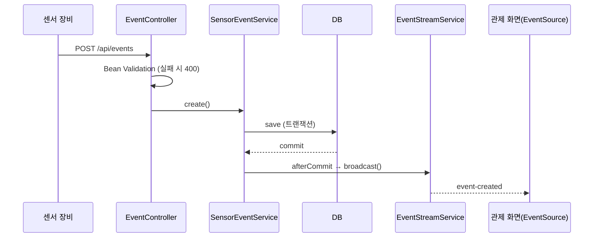

# event-ingest-spring

센서 장비가 보내는 이벤트를 받아 저장하고, 관제 화면에 SSE로 바로 알리는 Spring Boot 예제입니다.
실제 프로젝트의 이벤트 수신 API와 실시간 알림 구조를 회사 코드 없이 새로 구현했습니다. → [설계 문서](../../docs/01-collector-go-rebuild.md)

Java 17 · Spring Boot 3.3 · Spring Data JPA · Bean Validation · H2

## API

| 메서드 | 경로 | 설명 |
|---|---|---|
| `POST` | `/api/events` | 이벤트 등록. 검증 실패 시 400 + 필드별 사유 |
| `GET` | `/api/events` | 저장된 이벤트 조회 |
| `GET` | `/api/events/stream` | SSE 구독. 새 이벤트마다 `event-created` 전송 |

```json
POST /api/events
{"deviceCode":"DAS","channelNumber":1,"distanceM":1200.0,"value":0.82,"eventTime":"2026-01-15T09:00:00+09:00"}
```

## 설계에서 신경 쓴 부분



- **입구에서 막기**: 채널 범위, 음수 거리, 미래 시각, 누락된 값은 저장 전에 400으로 돌려보냅니다. `value`를 `Double`로 받아서 필드가 빠졌을 때 0.0으로 조용히 저장되는 일을 막습니다.
- **커밋 뒤에 알리기**: 알림은 `afterCommit`에서 보냅니다. 롤백된 이벤트가 화면에 먼저 뜨는 일을 막고, 테스트로 확인합니다(`BroadcastAfterCommitTest`).
- **폴링 대신 즉시 push**: DB를 주기적으로 조회해 새 행을 찾지 않고, 저장이 끝난 시점에 바로 보냅니다.
- **자원에 상한 두기**: 동시 구독자 수에 상한이 있고, 넘으면 503을 돌려줍니다. 전송에 실패한 연결은 그 자리에서 제거합니다. 실제 운영에서 상한 없는 누적 때문에 힙이 98GB까지 늘어난 장애를 겪은 뒤로 지키는 원칙입니다. → [장애 분석](../../docs/02-incident-analysis.md)

## 실행

```bash
./gradlew test       # 테스트 7개
./gradlew bootRun    # http://localhost:8080
```
