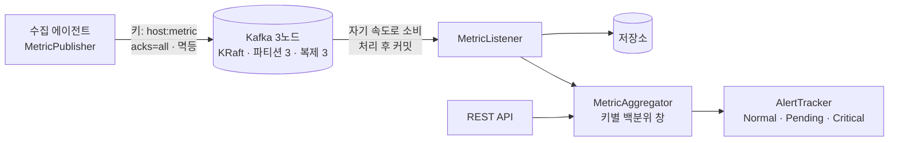

# metrics-pipeline-kafka

수집 에이전트가 서버로 직접 보내던 구조를, 중간에 Kafka(KRaft)를 두어 **수집과 처리를 분리**하는 구조로 바꿨을 때의 모습을 보여주는 예제입니다. 서버는 Kafka에서 받은 지연 시간 표본으로 P50·P95·P99를 계산하고, 단계별 알림 상태(Normal → Pending → Critical)를 판정합니다.

개인 학습·포트폴리오용으로 새로 작성한 코드입니다.

Java 17 · Spring Boot 3.3 · Spring for Apache Kafka · Kafka 3.8 (KRaft)

## 구조



## 설계 포인트

| 문제 | 대응 |
|---|---|
| 직접 전송하면 서버가 느려질 때 수집 쪽까지 막히고, 서버가 내려간 동안의 데이터는 사라짐 | 에이전트는 Kafka에 쓰기만 하고, 서버는 자기 속도로 읽음. 서버가 내려가도 데이터는 Kafka에 남아 있다가 다시 올라오면 이어서 처리 |
| ZooKeeper를 따로 운영해야 함 | KRaft 모드. 노드마다 broker와 controller를 함께 띄우고 컨트롤러 3표로 과반 유지 |
| 브로커 1대 장애 | 복제 3벌, `min.insync.replicas=2`, 프로듀서 `acks=all`. 1대가 죽어도 쓰기 계속 |
| 재전송 시 중복 | 멱등 프로듀서(`enable.idempotence=true`) |
| 처리 중 저장 실패 | 자동 커밋을 끄고 처리가 끝난 레코드만 커밋. 실패하면 같은 레코드를 0.2초 간격으로 다시 처리 |
| 같은 장비의 순서 | 키를 `host:metric`으로 두어 같은 파티션으로 보냄 |
| 평균에 묻히는 긴 지연 | P50·P95·P99를 함께 계산. P50은 그대로인데 P99만 오르면 일부 요청만 느린 것 |
| 키가 늘면 메모리도 늘어남 | 키마다 최근 N개만 담는 고정 크기 창 |
| 순간적인 튐에도 위험 알림 | 기준을 넘으면 Pending, 연속 N번 넘으면 Critical, 기준 아래로 돌아오면 해제 |

## API

| 메서드 | 경로 | 설명 |
|---|---|---|
| `POST` | `/api/metrics` | 표본을 Kafka에 발행 (`{"host":"db-1","metric":"latency_ms","value":12.5,"timestampMillis":0}`) |
| `GET` | `/api/metrics/{host}/{metric}` | 개수, P50·P95·P99·최대값, 알림 상태 |

## 테스트

```bash
./gradlew test
```

내장 Kafka를 **KRaft 모드**로 띄워 전체 흐름을 확인합니다. Docker가 필요 없습니다. 로컬 실행 결과 8개 모두 통과했습니다.

| 테스트 | 확인하는 것 |
|---|---|
| `KafkaPipelineIntegrationTest` | 1~100을 발행하면 P50·P95·P99가 50·95·99. 저장소가 한 번 실패해도 재처리되어 100건 모두 반영 |
| | 긴 지연 3번 → Critical, 정상 값으로 창이 채워지면 → Normal |
| `PercentileWindowTest` | 백분위 계산, 평균에 묻히는 긴 지연, 창 크기 상한 |
| `AlertTrackerTest` | Pending → Critical 격상, 순간적인 튐 해제 |

## 3노드 클러스터로 실행

```bash
docker compose up -d
./gradlew bootRun
```

`docker-compose.yml`은 3노드 KRaft(combined 모드) 구성입니다. 작성 환경에 Docker가 없어 compose 실행은 확인하지 못했습니다. 테스트는 위의 내장 KRaft 브로커로 확인했습니다.
